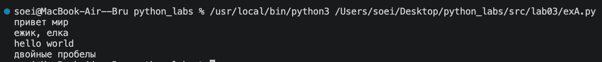
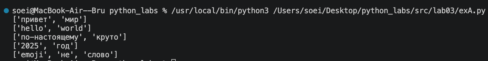
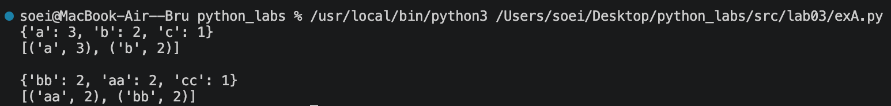
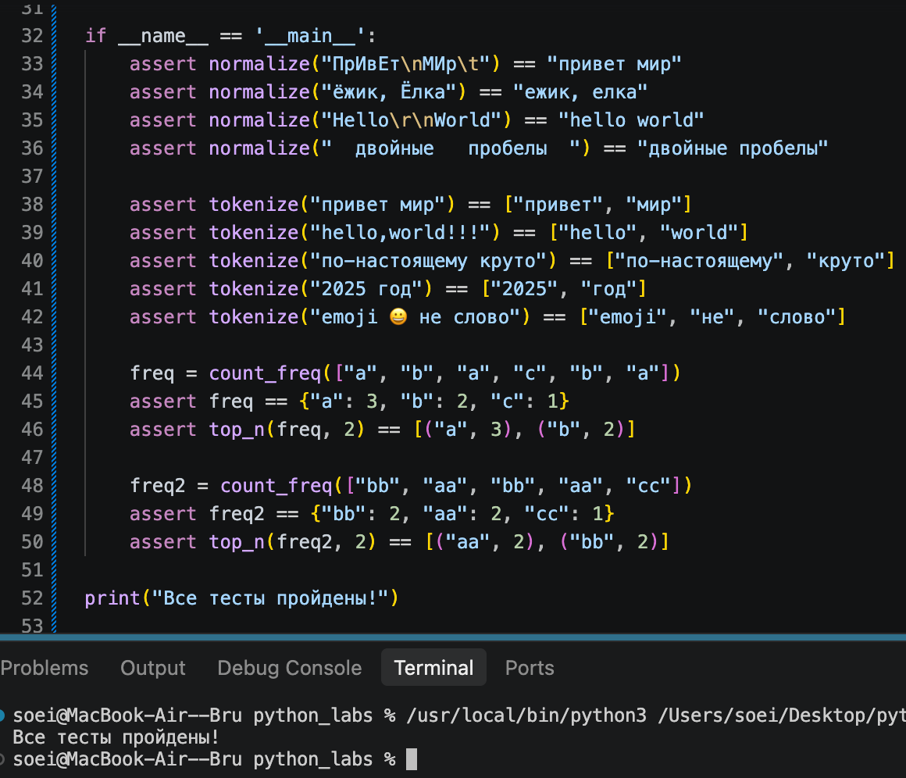

# python_labs
# Лабораторная работа 3

# Функция normalize
### Функция normalize выполняет предварительную обработку текста: в зависимости от флагов она приводит все буквы к нижнему регистру (используя casefold или lower) и заменяет буквы «ё»/«Ё» на «е»/«Е». Затем с помощью связки методов text.split() и ' '.join() строка разбивается по любым пробельным символам (табуляциям, переносам строк) и собирается обратно, что позволяет удалить невидимые управляющие символы, схлопнуть множественные пробелы в один и обрезать пустые края строки.

```python 
def normalize(text: str, *, casefold: bool = True, yo2e: bool = True) -> str:
    
    if casefold:
        text = text.casefold()
    else:
        text = text.lower()
        
    if yo2e:
        text = text.replace('ё', 'е').replace('Ё', 'Е')
        
    return ' '.join(text.split())
```


# Функция tokenize
### Функция вызывает re.findall с регулярным выражением. Сначала шаблон ищет последовательность из одной или нескольких букв, цифр или знаков подчеркивания (\w+). Затем проверяется необязательная группа (?:-\w+)*: она ищет дефис и следующие за ним символы \w+. Знак * означает, что таких связок «дефис + слово» может быть ноль или более раз. Конструкция ?: используется для группировки без захвата (нам не нужен отдельный результат для хвоста, нужно всё слово целиком). Всё, что не подходит под шаблон (пробелы, знаки препинания, эмодзи), просто игнорируется. Функция возвращает список найденных слов.

``` python
import re

def tokenize(text: str) -> list[str]:
    return re.findall(r'\w+(?:-\w+)*', text)
```


# Функция count_freq + top_n
### Вызываем функцию подсчёта частот. Создаём пустой словарь freq, в котором будем хранить частоты слов. Перебираем список tokens в цикле. Метод get() пытается получить текущее значение по ключу token. Если такого ключа в словаре ещё нет, он возвращает 0, а если есть - текущее число. Прибавляем 1 к этому значению (так как мы встретили слово ещё раз) и сохраняем обратно в словарь. Функция возвращает готовый словарь, где ключ - слово, а значение - количество его вхождений.

### Вызываем функцию вывода самых популярных слов. Сначала проверяем: если n < 0, выбрасываем ошибку ValueError (нельзя вернуть отрицательное количество слов). По умолчанию n = 5 (сколько топ-слов вернуть). Метод items() превращает словарь в список пар (кортежей). Функция sorted() сортирует этот список. Лямбда-функция берёт x как одну пару (слово, частота) и формирует ключ сортировки (-x[1], x[0]):

``` python
def count_freq(tokens: list[str]) -> dict[str, int]:
    freq = {}
    for token in tokens:
        freq[token] = freq.get(token, 0) + 1
    return freq

def top_n(freq: dict[str, int], n: int = 5) -> list[tuple[str, int]]:
    if n < 0:
        raise ValueError
    return sorted(freq.items(), key = lambda x: (-x[1], x[0]))[:n]
```


# Контрольные мини тесты
### Выполняется только при прямом запуске файла и игнорируется при его импорте благодарz if __name__ == '__main__':


# Скрипт src/text_stats.py 
### 