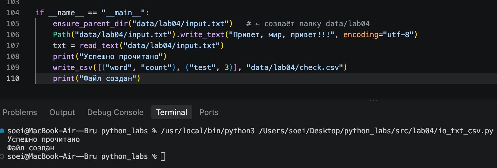
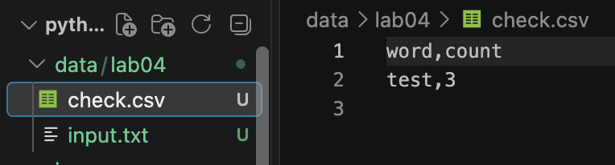
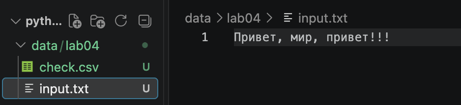
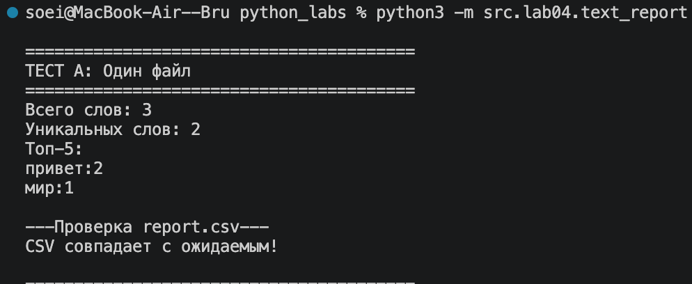
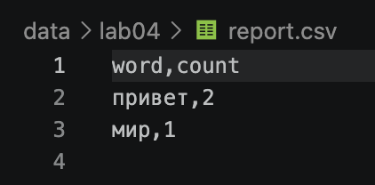
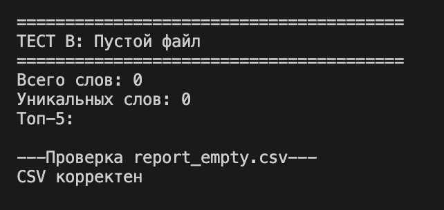
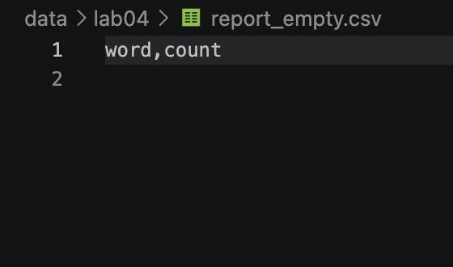
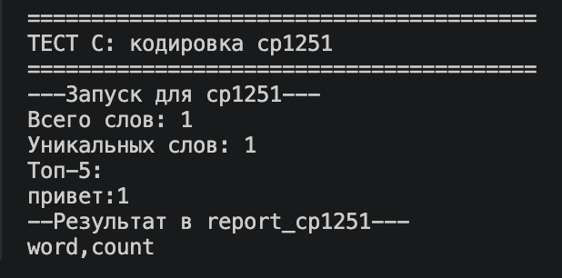
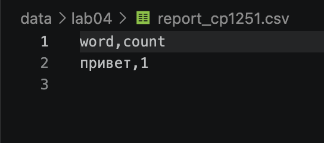

# python_labs
# Лабораторная работа 4

# Задание A — модуль src/lab04/io_txt_csv.py

## Функция read_text
Читает файл целиком и возвращает содержимое в виде одной строки. 
По умолчанию используется кодировка UTF-8. Внутри функции создается объект 
Path из переданного пути. Если файл не найден, возникает FileNotFoundError. 
При несовпадении кодировки возникает UnicodeDecodeError.

``` python
import csv
from pathlib import Path
from typing import Iterable, Sequence

def read_text(path: str | Path, encoding: str = "utf-8") -> str:
    """
    Читает текстовый файл и возвращает его содержимое одной строкой.

    Ошибки FileNotFoundError (если файла нет) и UnicodeDecodeError 
    (если кодировка не подходит) намеренно не перехватываются и 
    пробрасываются вызывающему коду.

    Args:
        path (str | Path): Путь к файлу.
        encoding (str): Кодировка файла. По умолчанию "utf-8". 
                        Пользователь может выбрать другую, например encoding="cp1251".

    Returns:
        str: Содержимое файла в виде одной строки.
    """
    p = Path(path)
    return p.read_text(encoding=encoding)
```

## Функция ensure_parent_dir
Создает все родительские папки для указанного файла, если их еще нет. 
Полезна перед записью: если папки не существует, обычная запись упадет 
с ошибкой FileNotFoundError, а эта функция создаст всю цепочку директорий. 
Если папка уже существует, ошибка не возникает.

``` python
def ensure_parent_dir(path: str | Path) -> None:
    """
    Создаёт все родительские директории для указанного файла, если их ещё нет.

    Функция полезна перед записью в файл: если папки, в которой должен
    лежать файл, не существует, обычная запись упадёт с ошибкой
    FileNotFoundError. Вызов этой функции заранее решает проблему.

    Если папка уже существует - ошибка не выбрасывается, функция
    просто завершает работу.

    Args:
        path: путь к файлу (не к папке) — строка или объект Path.

    Returns:
        None.
    """
    p = Path(path)
    # parents=True  — создаёт все промежуточные папки в цепочке (a/b/c),
    #                 а не только последнюю.
    # exist_ok=True — не выбрасывает ошибку, если папка уже существует.
    p.parent.mkdir(parents=True, exist_ok=True)
```

## Функция write_csv
Записывает строки в CSV-файл с разделителем «запятая». Существующий файл 
перезаписывается. Заголовок (если передан) пишется первой строкой. 
Перед записью проверяется, что все строки таблицы — это списки или кортежи 
(иначе TypeError), и что они имеют одинаковую длину (иначе ValueError). 
Запись идет через csv.writer с кодировкой UTF-8 и параметром newline="" 
(чтобы избежать лишних пустых строк на Windows).

``` python
def write_csv(rows: Iterable[Sequence], path: str | Path, header: tuple[str, ...] | None = None) -> None:
    """
    Записывает строки в CSV-файл с разделителем «запятая».

    Существующий файл перезаписывается. Запись идёт через csv.writer,
    поэтому значения с запятыми и кавычками экранируются автоматически.
    Пустой rows без header создаёт пустой файл, с header — файл только
    с заголовком.

    Args:
        rows: строки таблицы; все должны быть одинаковой длины.
        path: путь к создаваемому файлу — строка или Path.
        header: заголовок таблицы; если None, заголовок не пишется.

    Returns:
        None.

    Raises:
        TypeError: если строка таблицы не список и не кортеж.
        ValueError: если строки в rows разной длины (или не совпадают с длиной header).
    """
    rows = list(rows)
    p = Path(path)
    # 1. Проверка типов строк (до открытия файла, чтобы не оставить битый csv).
    for row in rows:
        if not isinstance(row, (list, tuple)):
            raise TypeError(
                f"Строка таблицы должна быть списком или кортежем,а получен {type(row).__name__}.")

    # 2. Определяем эталонную длину строки.
    if not rows:
        standard = len(header) if header is not None else 0
    else:
        standard = len(rows[0]) if header is None else len(header)

    # 3. Проверка, что все строки одной длины.
    for i, row in enumerate(rows):
        if len(row) != standard:
            raise ValueError(
                f"Ошибка: строка {i} имеет длину {len(row)}, а ожидалась {standard}.")
            
    # 4. Создаём папки, если их нет.
    ensure_parent_dir(path)

    # 5. Запись в файл.
    with p.open("w", newline="", encoding="utf-8") as file:
        w = csv.writer(file)
        if header is not None:
            w.writerow(header)
        for r in rows:
            w.writerow(r)
```
## Мини‑тесты (ручные, для README)





# Задание B — скрипт src/lab04/text_report.py

## Функция generate_report
Читает текст из входного файла. С помощью функций из ЛР3 нормализует его, разбивает на слова и считает частоты. Находит топ-5 слов, записывает их в CSV с заголовком word,count, а затем выводит в консоль общее количество слов, число уникальных слов и сам список топ-5.

``` python
from src.lab04.io_txt_csv import read_text, write_csv, ensure_parent_dir
from src.lib.text import normalize, tokenize, top_n, count_freq
import argparse
import sys
from pathlib import Path


def generate_report(input_path: str | Path, output_path: str | Path, encoding: str = "utf-8"):
    """
    Читает текст, считает частоты слов и сохраняет отчет в CSV.
    Выводит краткое резюме в консоль.
    """
    # 1. Читаем текст, передаем кодировку
    text = read_text(input_path, encoding=encoding)
    
    # 2. Обрабатываем
    normal_text = normalize(text)     # нормализация (нижний регистр, ё->е)
    tokens = tokenize(normal_text)    # токенизация (разбиение на слова)
    freq = count_freq(tokens)         # подсчет частот (словарь {слово: частота})
    top_5 = top_n(freq, 5)            # топ-5 для консоли

    # 3. Записываем CSV (все отсортированные слова)
    ensure_parent_dir(output_path)   # создаем папку, если ее нет
    write_csv(top_5, output_path, header=("word", "count"))

    # 4. Выводим резюме в консоль
    total_words = len(tokens)    # всего слов (с повторами)
    unique_words = len(freq)     # уникальных слов (ключей в словаре)

    print(f"Всего слов: {total_words}")
    print(f"Уникальных слов: {unique_words}")
    print("Топ-5:")
    for word, count in top_5:
        print(f"{word}:{count}")
```

# Тест‑кейсы

## A. Один файл (база)
Создает текстовый файл input.txt с тестовой строкой. Запускает generate_report, которая формирует report.csv. Затем читает полученный CSV и сравнивает его с эталонной строкой. Если они совпадают, выводится сообщение об успехе, иначе — об ошибке.

``` python
def run_test_a():
    '''Тест А: обычный файл с текстом'''
    print("\n" + "="*40)
    print("ТЕСТ А: Один файл")
    print("="*40)

    input_file = "data/lab04/input.txt"
    output_file = "data/lab04/report.csv"

    ensure_parent_dir(input_file)
    Path(input_file).write_text("Привет, мир, привет!!!", encoding = "utf-8")

    #Запускаем генерацию
    generate_report(input_file, output_file)

    #Проверяем CSV
    print("\n---Проверка report.csv---")
    actual_csv = read_text(output_file)
    expected_csv = "word,count\nпривет,2\nмир,1\n"
    if actual_csv==expected_csv:
        print("CSV совпадает с ожидаемым!")
    else:
        print("Ошибка! CSV не совпадает с ожидаемым")
```



## B. Пустой файл
Создает пустой входной файл и запускает generate_report. Затем читает полученный CSV и сравнивает его с эталоном (строка только с заголовком). Проверяет, что при пустом входе отчет формируется корректно (без строк с данными).

``` python
def run_test_b_empty():
    '''Тест B: пустой файл'''
    print("\n" + "="*40)
    print("ТЕСТ B: Пустой файл")
    print("="*40)

    input_file = "data/lab04/empty.txt"
    output_file = "data/lab04/report_empty.csv"

    #Создаем пустой входной файл
    write_csv([],input_file)
    #Запускаем генерацию
    generate_report(input_file,output_file)

    #Проверяем CSV
    print("\n---Проверка report_empty.csv---")
    actual_csv = read_text(output_file)
    expected_csv = "word,count\n"
    if actual_csv==expected_csv:
        print("CSV корректен")
    else:
        print("CSV не совпадает")
```



## C. Кодировка cp1251
Создает текстовый файл input_cp1251.txt с текстом «Привет», сохраненным в кодировке cp1251. Запускает generate_report с параметром encoding="cp1251". Выводит результат созданного CSV-файла в консоль, проверяя, что нестандартная кодировка читается корректно.

``` python
def run_test_c():
    '''Тест С: кодировка cp1251'''
    print("\n" + "="*40)
    print("ТЕСТ С: кодировка cp1251")
    print("="*40)
    
    input_file = "data/lab04/input_cp1251.txt"
    output_file = "data/lab04/report_cp1251.csv"

    ensure_parent_dir(input_file)
    Path(input_file).write_text("Привет", encoding = "cp1251")

    print("---Запуск для cp1251---")
    generate_report(input_file,output_file,encoding="cp1251")
    print("--Результат в report_cp1251---")
    print(read_text(output_file))

if __name__ == "__main__":
    run_test_a()
    run_test_b_empty()
    run_test_c()
```

