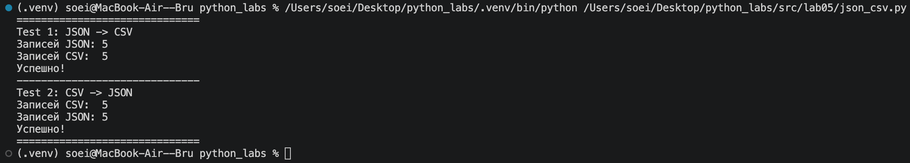
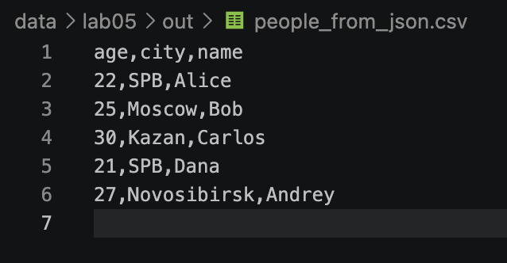
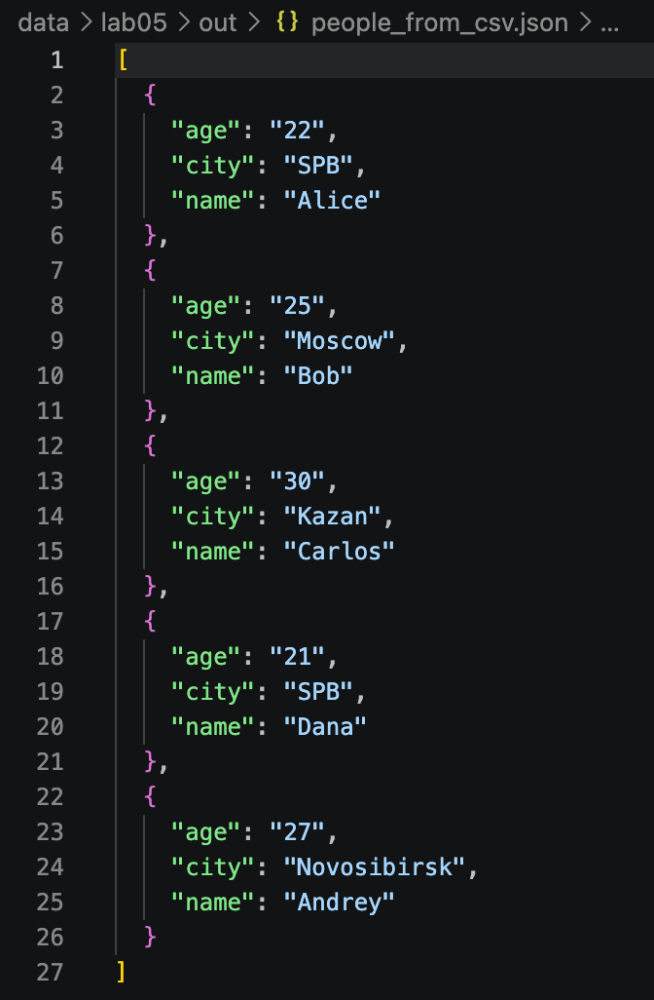
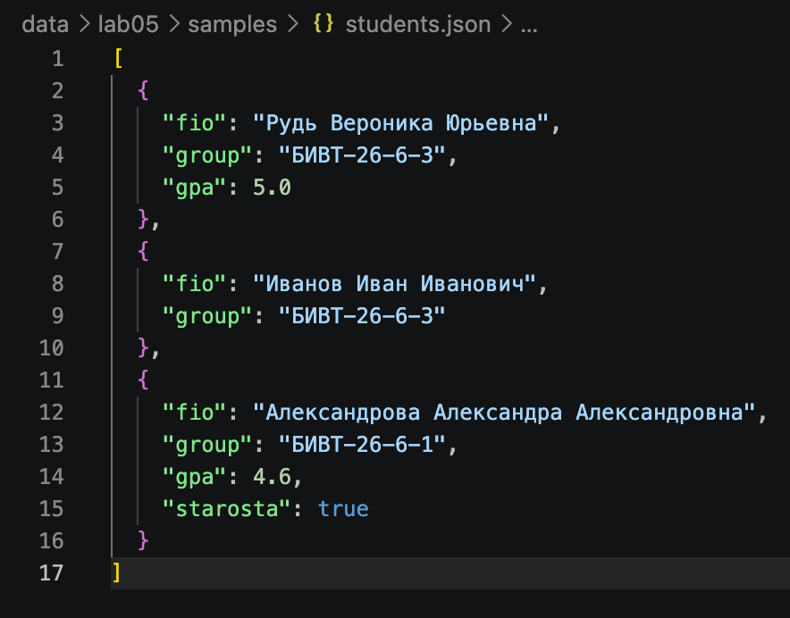
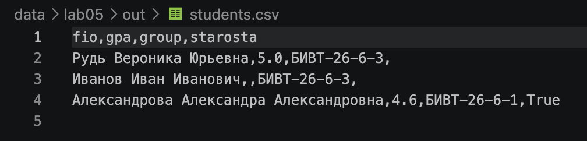
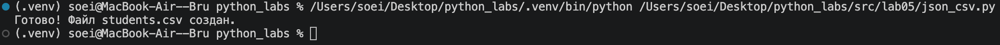
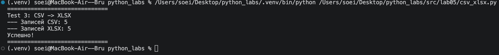
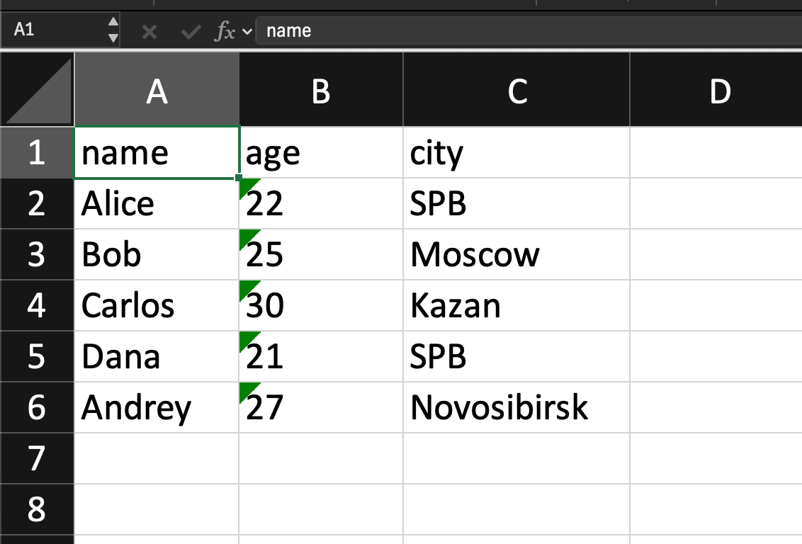

# python_labs
# Лабораторная работа 5 — JSON и конвертации
## Задание A — JSON ↔ CSV

### Модуль: src/lab05/json_csv.py
``` python
import json
import csv
from pathlib import Path

def json_to_csv(json_path: str, csv_path: str) -> None:
    ''' Преобразует JSON со списком словарей в CSV
    Отсутствующие поля заполняются пустой строкой.
    Порядок колонок - алфавитный.
    
    Raises:
        FileNotFoundError: входного файла нет
        ValueError: не то расширение, пустой файл или не список словарей
    '''
    json_file = Path(json_path)
    if not json_file.is_file():
        raise FileNotFoundError(f"Файл не найден: {json_path}")
    
    # Добавлена проверка расширения (требование ТЗ)
    if json_file.suffix.lower() != '.json':
        raise ValueError(f"Неверный тип файла. Ожидался .json, получен: {json_file.suffix}")

    try:
        with open(json_file, 'r', encoding='utf-8') as f:
            data = json.load(f)
    except json.JSONDecodeError:
        raise ValueError("Неверный формат JSON или файл пуст")
    
    if not isinstance(data, list) or not data:
        raise ValueError('JSON должен содержать непустой список объектов (словарей)')
    if not all(isinstance(item, dict) for item in data):
        raise ValueError('Все элементы списка в JSON должны быть словарями')

    all_keys = set()
    for item in data:
        all_keys.update(item.keys())
    headers = sorted(list(all_keys))

    if not headers:
        raise ValueError('В JSON отсутствуют данные для создания колонок')
        
    try:
        with open(csv_path, 'w', encoding='utf-8', newline='') as f:
            writer = csv.DictWriter(f, fieldnames=headers)
            writer.writeheader()
            for row in data:
                writer.writerow(row)
    except Exception as e:
        raise ValueError(f"Ошибка при записи CSV файла: {e}")


def csv_to_json(csv_path: str, json_path: str) -> None:
    '''Преобразовать CSV в JSON со списком словарей
    Первая строка в CSV - заголовок

    Raises:
        FileNotFoundError: входного файла нет
        ValueError: не то расширение, нет заголовка или нет ни одной записи
    '''
    csv_file = Path(csv_path)
    if not csv_file.is_file():
        raise FileNotFoundError(f"Файл не найден: {csv_path}")
        
    # Добавлена проверка расширения (требование ТЗ)
    if csv_file.suffix.lower() != '.csv':
        raise ValueError(f"Неверный тип файла. Ожидался .csv, получен: {csv_file.suffix}")

    try:
        with open(csv_file, 'r', encoding='utf-8', newline='') as f:
            reader = csv.DictReader(f)
            if reader.fieldnames is None:
                raise ValueError('CSV-файл пуст или нет заголовка')
            data = list(reader)
        if not data:
            raise ValueError('CSV-файл не содержит данных (только заголовок)')
        
    except csv.Error as e:
        raise ValueError(f"Ошибка чтения CSV: {e}")
    
    try:
        Path(json_path).parent.mkdir(parents=True, exist_ok=True)
        
        with open(json_path, 'w', encoding='utf-8') as f:
            json.dump(data, f, ensure_ascii=False, indent=2)
    except IOError as e:
        raise ValueError(f"Ошибка записи JSON: {e}")
```
### Особенности реализации:

json_to_csv():
* Принимает путь к JSON и путь для сохранения CSV.
* Собирает все уникальные ключи из списка словарей.
* Порядок колонок — алфавитный (отсортированный список ключей).
* Отсутствующие поля в словарях заполняются пустыми строками (благодаря csv.DictWriter).

csv_to_json():
* Читает CSV с заголовком.
* Сохраняет данные в формате списка словарей с отступами (indent=2) и без экранирования кириллицы (ensure_ascii=False).

### Обработка ошибок:

FileNotFoundError: 
* если входной файл не существует.
ValueError:
* Неверное расширение файла (не .json или не .csv).
* Пустой файл или отсутствие заголовков.
* JSON не является списком словарей.

## Тесты задания А и проверка на совпадение длины


### Примеры данных и результаты

- `data/lab05/out/students.csv` — результат JSON → CSV;
- `data/lab05/samples/people.json` — список людей в формате JSON;
- `data/lab05/samples/people.csv` — те же данные в формате CSV;
- `data/lab05/samples/cities.csv` — дополнительный CSV с городами;
- `data/lab05/out/people_from_json.csv` — результат JSON → CSV;
- `data/lab05/out/people_from_csv.json` — результат CSV → JSON;

## Проверка результатов

### 1. JSON -> CSV

*Рис 1. Результат преобразования JSON в CSV.*

### 2. CSV -> JSON

*Рис. 2. Результат преобразования CSV в JSON.*

### 3. Доп. проверка / JSON -> CSV
Проверка на разных данных:
В файле students.json у всех студентов разный набор полей: у второго нет оценки (gpa), а у третьего появилось новое поле (starosta). Программа успешно справилась с этим: она собрала все названия колонок из всех студентов, а там, где данных не хватало, просто оставила пустые места. Ничего не потерялось, колонки не съехали.





## Задание B — CSV → XLSX

### Модуль: src/lab05/csv_xlsx.py
``` python
import csv
from pathlib import Path
from openpyxl import Workbook, load_workbook
from openpyxl.utils import get_column_letter

def csv_to_xlsx(csv_path: str, xlsx_path: str) -> None:
    '''Преобразует CSV в XLSX.
    Первая строка CSV — заголовок. Лист называется "Sheet1".
    Ширина колонок — авто-ширина по тексту (не менее 8).
    '''
    source = Path(csv_path)
    target = Path(xlsx_path)

    # 1. Валидация файлов
    if not source.is_file():
        raise FileNotFoundError(f"Файл не найден: {csv_path}")
    if source.suffix.lower() != ".csv":
        raise ValueError("Входной файл должен быть CSV")
    if target.suffix.lower() != ".xlsx":
        raise ValueError("Выходной файл должен быть XLSX")
    
    # 2. Чтение CSV
    rows = []
    try:
        with source.open(encoding="utf-8", newline="") as f:
            for row in csv.reader(f):
                if row: # Пропускаем пустые строки
                    rows.append(row)
    except Exception as e:
        raise ValueError(f"Ошибка чтения CSV: {e}")

    # 3. Проверка на наличие данных (заголовок + хотя бы одна строка)
    if len(rows) < 2:
        raise ValueError("В CSV нет данных (только заголовок или файл пуст)")

    # 4. Запись в Excel
    try:
        wb = Workbook()
        ws = wb.active
        ws.title = "Sheet1"
        
        for row in rows:
            ws.append(row)

        # 5. Авто-ширина колонок
        widths = {}
        for row in rows:
            for i, value in enumerate(row, start=1):
                # str() на случай, если попадутся не строки
                widths[i] = max(widths.get(i, 0), len(str(value)))

        for i, width in widths.items():
            ws.column_dimensions[get_column_letter(i)].width = max(width, 8)

        # Создаем папку, если её нет, и сохраняем
        target.parent.mkdir(parents=True, exist_ok=True)
        wb.save(xlsx_path)
        
    except Exception as e:
        raise ValueError(f"Ошибка при создании XLSX файла: {e}")
```
### Особенности реализации:

* Используется библиотека openpyxl.
* Первая строка CSV становится заголовком листа.
* Лист называется "Sheet1".
* Авто-ширина колонок: вычисляется максимальная длина текста в каждой колонке, к ней добавляется отступ. Минимальная ширина установлена в 8 символов.
* Реализована проверка расширений и создание директорий, если их нет.

### Обработка ошибок:

FileNotFoundError: 
* если CSV-файл отсутствует.
ValueError: 
* неверное расширение, пустой CSV или ошибки записи XLSX.

## Тесты задания В и проверка на совпадение длины

- создается файл `people_from_csv.xlsx`
- `data/lab05/out/people.xlsx` — результат CSV → XLSX.


