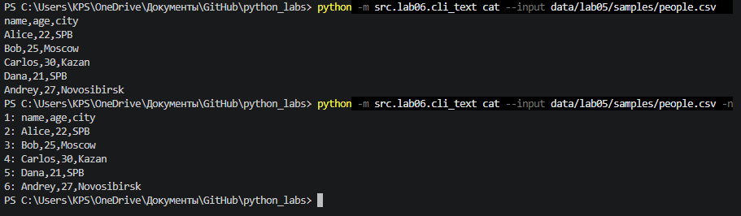
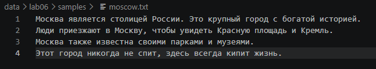
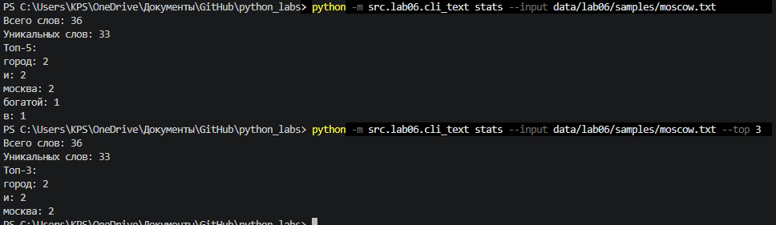
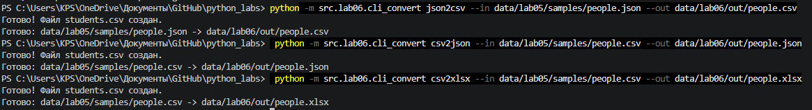
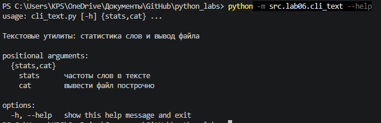

# python_labs
# ЛР6 — CLI‑утилиты с argparse (cat/grep‑lite + конвертеры)
## Модуль src/lab06/cli_text.py

Модуль реализует консольную утилиту для работы с текстовыми файлами с использованием argparse. Утилита предоставляет две подкоманды:

-stats — анализ частотности слов. Принимает обязательный аргумент --input (путь к файлу) и опциональный --top (количество выводимых слов, по умолчанию 5). Функция run_stats читает файл, нормализует текст, разбивает его на токены, подсчитывает частоту и выводит общее количество слов, число уникальных слов и список самых частых слов с их количеством.

-cat — построчный вывод содержимого файла. Принимает --input и флаг -n (включает нумерацию строк). Функция run_cat использует splitlines() для корректного разбиения текста на строки без лишних переносов.

Организация парсинга: в функции main() создается ArgumentParser с подпарсерами через add_subparsers(dest="command", required=True). Выбранная команда сохраняется в args.command, после чего через if/elif вызывается соответствующая функция.

Обработка ошибок: перед выполнением проверяется, что --top больше нуля. Блок выполнения обернут в try/except, перехватывающий FileNotFoundError и UnicodeDecodeError. Все ошибки выводятся через parser.error() — в понятном виде, без стектрейса.

Переиспользование кода: модуль не дублирует логику — используется read_text из ЛР4 и функции normalize, tokenize, count_freq, top_n из вспомогательного модуля.

``` python
import argparse

from src.lab04.io_txt_csv import read_text
from src.lib.text import count_freq, normalize, tokenize, top_n


def run_stats(path: str, top: int) -> None:
    """Напечатать число слов и топ самых частых."""
    tokens = tokenize(normalize(read_text(path)))
    freq = count_freq(tokens)

    print(f"Всего слов: {len(tokens)}")
    print(f"Уникальных слов: {len(freq)}")
    print(f"Топ-{top}:")
    for word, count in top_n(freq, top):
        print(f"{word}: {count}")


def run_cat(path: str, numbered: bool) -> None:
    """Напечатать файл построчно, с номерами строк если numbered=True."""
    lines = read_text(path).splitlines()
    for number, line in enumerate(lines, start=1):
        if numbered:
            print(f"{number}: {line}")
        else:
            print(line)


def main(argv=None) -> None:
    parser = argparse.ArgumentParser(
        description="Текстовые утилиты: статистика слов и вывод файла"
    )
    sub = parser.add_subparsers(dest="command", required=True)

    stats_parser = sub.add_parser("stats", help="частоты слов в тексте")
    stats_parser.add_argument("--input", required=True, help="текстовый файл")
    stats_parser.add_argument("--top", type=int, default=5, help="сколько слов показать")

    cat_parser = sub.add_parser("cat", help="вывести файл построчно")
    cat_parser.add_argument("--input", required=True, help="файл для вывода")
    cat_parser.add_argument("-n", action="store_true", help="нумеровать строки")

    args = parser.parse_args(argv)

    if args.command == "stats" and args.top < 1:
        parser.error("--top должен быть положительным числом")

    try:
        if args.command == "stats":
            run_stats(args.input, args.top)
        elif args.command == "cat":
            run_cat(args.input, args.n)
    except FileNotFoundError:
        parser.error(f"файл не найден: {args.input}")
    except UnicodeDecodeError:
        parser.error(f"файл {args.input} не читается в кодировке UTF-8")


if __name__ == "__main__":
    main()
```
## Выводы
### cat — вывод файла
```
python -m src.lab06.cli_text cat --input data/lab05/samples/people.csv
python -m src.lab06.cli_text cat --input data/lab05/samples/people.csv -n
```
Файл читается в UTF-8. С флагом `-n` каждая строка получает номер в формате `1: содержимое строки`.



### stats — частоты слов

```
python -m src.lab06.cli_text stats --input data/lab06/samples/moscow.txt
python -m src.lab06.cli_text stats --input data/lab06/samples/moscow.txt --top 3 
```
Функция выводит общее количество слов, количество уникальных слов, а затем список самых частых слов в формате слово: количество. По умолчанию выводится Топ-5, но с помощью флага --top можно задать любое другое положительное число. Значение --top проверяется: если оно меньше 1, программа выдает ошибку.



## Модуль src/lab06/cli_convert.py

Модуль реализует консольную утилиту для конвертации файлов между форматами JSON, CSV и XLSX с использованием argparse. Программа выступает оберткой над функциями конвертации, написанными в ЛР5.

Функциональность подкоманд:

json2csv — конвертация JSON в CSV.

csv2json — конвертация CSV в JSON.

csv2xlsx — конвертация CSV в XLSX.

Каждая подкоманда принимает два обязательных аргумента: --in (путь к входному файлу) и --out (путь к выходному файлу). Флаг dest="input" используется, так как слово in является зарезервированным в Python.

Архитектура и парсинг аргументов:
В функции main() создается главный ArgumentParser с подпарсерами через add_subparsers(dest="command", required=True). Выбранная команда сохраняется в args.command, после чего через if/elif вызывается соответствующая функция конвертации.

Обработка ошибок и валидация:

Перед конвертацией автоматически создается выходная директория (os.makedirs), если её не существует (например, data/out/).

Блок выполнения обернут в try/except. Перехватываются FileNotFoundError (входной файл не найден) и ValueError (ошибка формата данных, текст берется из функций ЛР5). Все ошибки выводятся через parser.error() в понятном виде без стектрейса.

После успешного выполнения выводится сообщение Готово: <вход> -> <выход>.

Особенности реализации:
Модуль использует только стандартные библиотеки (argparse, os) и переиспользует готовые функции json_to_csv, csv_to_json, csv_to_xlsx из ЛР5. Код разделен на логические блоки, что обеспечивает читаемость и соответствует требованиям ТЗ.

``` python
import argparse
import os

from src.lab05.csv_xlsx import csv_to_xlsx
from src.lab05.json_csv import csv_to_json, json_to_csv


def main() -> None:
    parser = argparse.ArgumentParser(
        description="Конвертеры данных между JSON, CSV и XLSX"
    )
    sub = parser.add_subparsers(dest="command", required=True)

    # У всех трёх команд одинаковые флаги: откуда читать и куда писать.
    # dest нужен, потому что args.in — синтаксическая ошибка (in — ключевое слово).
    json2csv_parser = sub.add_parser("json2csv", help="JSON -> CSV")
    json2csv_parser.add_argument("--in", dest="input", required=True, help="входной JSON")
    json2csv_parser.add_argument("--out", dest="output", required=True, help="выходной CSV")

    csv2json_parser = sub.add_parser("csv2json", help="CSV -> JSON")
    csv2json_parser.add_argument("--in", dest="input", required=True, help="входной CSV")
    csv2json_parser.add_argument("--out", dest="output", required=True, help="выходной JSON")

    csv2xlsx_parser = sub.add_parser("csv2xlsx", help="CSV -> XLSX")
    csv2xlsx_parser.add_argument("--in", dest="input", required=True, help="входной CSV")
    csv2xlsx_parser.add_argument("--out", dest="output", required=True, help="выходной XLSX")

    args = parser.parse_args()

    # Создаём папку для результата, если её ещё нет (например, data/out/)
    out_dir = os.path.dirname(args.output)
    if out_dir and not os.path.exists(out_dir):
        os.makedirs(out_dir)

    try:
        if args.command == "json2csv":
            json_to_csv(args.input, args.output)
        elif args.command == "csv2json":
            csv_to_json(args.input, args.output)
        elif args.command == "csv2xlsx":
            csv_to_xlsx(args.input, args.output)
    except FileNotFoundError:
        parser.error(f"файл не найден: {args.input}")
    except ValueError as error:
        # текст ошибки берём из функций ЛР5, там он уже понятный
        parser.error(str(error))

    print(f"Готово: {args.input} -> {args.output}")


if __name__ == "__main__":
    main()
```
```
 python -m src.lab06.cli_convert json2csv --in data/lab05/samples/people.json --out data/lab06/out/people.csv
 python -m src.lab06.cli_convert csv2json --in data/lab05/samples/people.csv --out data/lab06/out/people.json
 python -m src.lab06.cli_convert csv2xlsx --in data/lab05/samples/people.csv --out data/lab06/out/people.xlsx
 ```


## Проверка --help для каждой подкоманды.
```
python -m src.lab06.cli_text --help
python -m src.lab06.cli_text stats --help
python -m src.lab06.cli_text cat --help
python -m src.lab06.cli_convert --help
python -m src.lab06.cli_convert json2csv --help
```
argparse автоматически генерирует красивый текст справки на основе тех описаний (help="..."), которые прописаны в коде.

