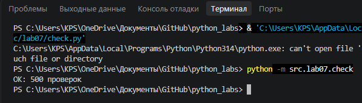
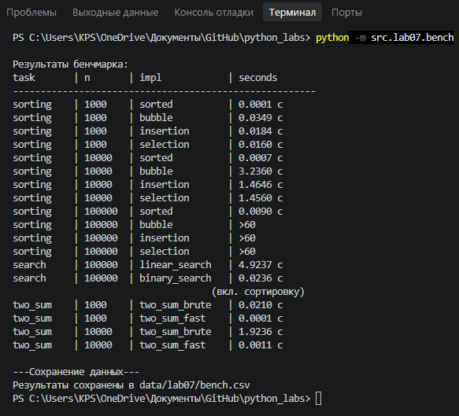

# python_labs
# ЛР7 — Поиск, сортировка и измерение времени

# Модуль src/lab07/search.py с функциями поиска:
```python
def linear_search(nums: list[int], x: int) -> int:
    """Индекс первого вхождения x или -1.
 
    linear_search([4, 2, 7, 2], 2) -> 1
    linear_search([4, 2, 7, 2], 9) -> -1
    linear_search([], 1) -> -1
    """
    for i in range(len(nums)):
        if nums[i]==x:
            return i
    return -1
```
- проходим по элементам списка от начала до конца, используя индексы
- сравниваем каждый текущий элемент с искомым x
- как только находим совпадение, сразу возвращаем индекс
- если дошел до конца и ничего не нашел, возвращаем -1

```python
def binary_search(sorted_nums: list[int], x: int) -> int:
    """
    Индекс x в отсортированном по возрастанию списке или -1
    На неотсортированном списке результат не определён.
    Возвращает индекс найденного элемента или -1, если элемент отсутствует.

    binary_search([1, 3, 5, 7], 5) -> 2
    binary_search([1, 3, 5, 7], 4) -> -1
    binary_search([5], 5) -> 0
    binary_search([], 5) -> -1
    """
    lo = 0
    hi = len(sorted_nums)-1
    while lo <= hi:
        mid = (lo + hi)//2
        if sorted_nums[mid] == x:
            return mid
        elif sorted_nums[mid] < x:
            lo = mid + 1
        else:
            hi = mid -1
    return -1
```
- работает только на отсортированных данных, ищет x
- заводим две границы: lo (начало) и hi (конец)
- на каждом шаге берем середину mid; если значение там меньше x, сдвигает lo вправо, если больше — сдвигаем hi влево
- так отбрасываем половину списка; если в итоге границы пересеклись, возвращаем -1

```python
def two_sum_brute(nums: list[int], target: int) -> tuple[int, int] | None:
    """Пара индексов (i, j), i < j, nums[i] + nums[j] == target, или None.
    Принимает список чисел и целевую сумму target.
    Возвращает кортеж с индексами (i, j) или None, если пара не найдена.
    Метод полного перебора (O(n^2)).
 
    two_sum_brute([2, 7, 11, 15], 9) -> (0, 1)
    two_sum_brute([1, 2], 10) -> None
    """
    n = len(nums)
    for i in range(n):
        for j in range(i+1, n): # j идет после i, чтобы число не складывалось само с собой
            if nums[i] + nums[j] == target:
                return(i,j)
    return None
```
- используем двойной цикл для перебора всех пар чисел
- внутренний цикл стартует с i + 1, чтобы не брать один и тот же элемент дважды
- если сумма nums[i] + nums[j] совпадает с target, возвращаем кортеж (i, j)
- если все пары проверены и совпадений нет, возвращаем None

```python
def two_sum_fast(nums: list[int], target: int) -> tuple[int,int] | None:
    """То же, что two_sum_brute
    Использует эффективный подход со словарём за один проход (O(n)).
    """
    seen = {} # хранение чисел в формате число:его индекс
    for i, x in enumerate(nums):
        diff = target - x
        if diff in seen:
            return(seen[diff], i)
        seen[x] = i
    return None
```
- идем по списку один проход, храня пройденные числа в словаре seen
- для каждого числа x вычисляем diff = target - x (то, чего не хватает до цели)
- проверяем, есть ли diff в словаре; если да — нашел пару, возвращаем индексы
- если нет, кладем текущее число в словарь и двигаемся дальше

# Модуль src/lab07/sorting.py. Три сортировки, каждая возвращает новый список и не меняет исходный:
```python
def bubble_sort(nums: list[int]) -> list[int]:
    """Новый список, отсортированный по возрастанию. Исходный не меняется.
    Флаг flag дает ранний выход.
 
    bubble_sort([3, 1, 2]) -> [1, 2, 3]
    bubble_sort([2, 2, 1]) -> [1, 2, 2]
    bubble_sort([]) -> []
    """
    a = list(nums)
    n = len(a)
    for i in range(n):
        flag = False
        for j in range(0, n - i - 1):
            if a[j] > a[j+1]:
                a[j], a[j+1] = a[j+1], a[j]
                flag = True
        if not flag:
            break
    return a
```
- создаем копию списка a = list(nums), чтобы не менять исходный
- внешний цикл for i, внутренний for j, сравниваем соседние элементы a[j] и a[j+1]
- если левый больше правого — меняем местами, ставим флаг flag = True
- если за целый проход не было обменов (flag остался False), значит список уже отсортирован — выходим из цикла досрочно

```python
def insertion_sort(nums: list[int]) -> list[int]:
    """Сортирует список методом вставок.
    Создает и возвращает новый отсортированный список, не меняя исходный.
    Принимает исходный, возвращает новый.
    """
    a = list(nums)
    for i in range(1,len(a)):
        key = a[i]
        j = i - 1
        while j>=0 and a[j]>key:
            a[j + 1] = a[j]
            j-=1 
        a[j + 1] = key
    return a
```
- создаем копию списка
- идем от второго элемента (i = 1) до конца
- запоминаем текущий элемент key = a[i] и сдвигаем вправо все элементы, которые больше key
- вставляем key на освободившееся место (a[j+1] = key)

```python
def selection_sort(nums: list[int]) -> list[int]:
    """Сортирует список методом выбора.
    Создает и возвращает новый отсортированный список, не изменяя исходный.
    Принимает исходный, возвращает новый.
    Сложность O(n^2)
    """
    a = list(nums)
    n = len(a)
    for i in range(n):
        minidx = i
        for j in range(i + 1, n):
            if a[j] < a[minidx]:
                minidx = j
        a[i], a[minidx] = a[minidx], a[i]
    return a
```
- создаем копию списка
- на каждом шаге i предполагаем, что минимальный элемент — это a[i] (запоминаем minidx = i)
- пробегаем по оставшейся части (j от i+1 до конца) и ищем реально минимальный элемент, обновляя minidx
- в конце меняем местами a[i] и a[minidx]

# Модуль src/lab07/check.py. Проверка против эталона на случайных данных:
```python
import random
from src.lab07.search import linear_search, binary_search, two_sum_brute, two_sum_fast
from src.lab07.sorting import bubble_sort, insertion_sort, selection_sort

def check_sorting(fn, trials: int = 100) -> int:
    """Проверяет функцию сортировки на случайных данных против эталонного sorted().
    Принимает конкретную функцию для проверки и кол-во испытаний (по умолчанию 100).
    Возвращает кол-во успешно пройденных тестов.
    """
    for _ in range(trials):
        n = random.randint(0, 50)
        nums = [random.randint(-100, 100) for _ in range(n)]
        original = list(nums)
        result = fn(nums)
        assert result == sorted(nums), f"{fn.__name__} ошиблась на {nums}: получено {result}, ожидалось {sorted(nums)}"
        assert nums == original, f"{fn.__name__} изменила исходный список"
    return trials
```
- запускаем цикл на trials раз (по умолчанию 100)
- генерируем случайный список nums длиной от 0 до 50 и создаем его копию original
- вызываем проверяемую функцию fn(nums) и сравниваем результат с эталоном sorted(nums) через assert; если не совпало — падаем с ошибкой и показываем список
- проверяем, что исходный nums не изменился (сравниваем с original)

```python
def check_search(trials: int = 100) -> int:
    """Проверяет функции linear_search и binary_search на случайных данных.
    Возвращает количество успешно пройденных испытаний.
    """
    for _ in range(trials):
        n = random.randint(0, 50)
        nums = [random.randint(-50, 50) for _ in range(n)]
        x = random.randint(-60, 60)

        # Линейный поиск против list.index
        try:
            expected_lin = nums.index(x)
        except ValueError:
            expected_lin = -1  # если числа нет, то правильный ответ(эталон) = -1
        
        actual_lin = linear_search(nums, x)
        assert actual_lin == expected_lin, f"linear_search ошиблась для поиска {x} в {nums}: получено {actual_lin}, ожидалось {expected_lin}"

        # Бинарный поиск
        sorted_nums = sorted(nums)
        try:
            expected_bin = sorted_nums.index(x)
        except ValueError:
            expected_bin = -1
            
        actual_bin = binary_search(sorted_nums, x)
        if expected_bin == -1:
            assert actual_bin == -1, f"binary_search не нашла элемент, которого нет: {x} в {sorted_nums}"
        else:
            assert actual_bin != -1 and sorted_nums[actual_bin] == x, f"binary_search вернула некорректный индекс {actual_bin} для {x} в {sorted_nums}"

    # Редкие случаи (граничные условия)
    assert binary_search([], 5) == -1
    assert binary_search([5], 5) == 0
    assert binary_search([5], 7) == -1
    assert binary_search([1, 3], 3) == 1

    return trials
```
- запускаем цикл на trials раз
- генерируем случайный список nums и искомое число x
- для linear_search сверяемся с list.index: оборачиваем его в try/except, чтобы получить -1 вместо ошибки, если элемента нет; сравниваем через assert
- для binary_search сортируем nums, ищем x через list.index; если элемента нет, проверяем, что функция вернула -1, если есть — проверяем, что по возвращенному индексу действительно лежит x
- в конце руками проверяем граничные случаи: пустой список, один элемент, элемент в начале/конце

```python
def check_two_sum(trials: int = 100) -> int:
    """Проверяет эквивалентность результатов two_sum_brute и two_sum_fast.
    Возвращает количество успешно пройденных тестов.
    """
    for _ in range(trials):
        n = random.randint(2, 30)
        nums = [random.randint(-30, 30) for _ in range(n)]
        target = random.randint(-50, 50)

        res_brute = two_sum_brute(nums, target)
        res_fast = two_sum_fast(nums, target)

        # Если медленный ничего не нашел, то быстрый тоже
        if res_brute is None:
            assert res_fast is None, f"two_sum_brute не нашла, а fast нашла {res_fast} для nums={nums}, target={target}"
            continue
        
        # Если медленный нашел, то быстрый тоже должен найти
        assert res_fast is not None, f"two_sum_brute нашла {res_brute}, fast не нашла для nums={nums}, target={target}"

        # Если нашли, проверяем сумму для обоих
        i, j = res_brute
        assert nums[i] + nums[j] == target, f"brute вернул неверные индексы: {res_brute}"
        i, j = res_fast
        assert nums[i] + nums[j] == target, f"fast вернул неверные индексы: {res_fast}"
        
    return trials 

if __name__ == "__main__":
    random.seed(42)  # одни и те же случайные данные для всех алгоритмов
    
    total = 0
    for fn in (bubble_sort, insertion_sort, selection_sort):
        total += check_sorting(fn, trials=100)
        
    total += check_search()
    total += check_two_sum()

    print(f"OK: {total} проверок")

# python -m src.lab07.check
```
- запускаем цикл на trials раз
- генерируем список nums и target
- запускаем обе функции: two_sum_brute и two_sum_fast
- если brute вернула None (пары нет), проверяем через assert, что fast тоже вернула None
- если brute нашла пару, проверяем, что fast тоже не None, и что сумма элементов по найденным индексам в обеих функциях равна target



# Модуль src/lab07/bench.py. Замеры через timeit и таблица результатов:
```python
import random
import timeit
import csv
from src.lab04.io_txt_csv import write_csv
from src.lab07.sorting import bubble_sort, insertion_sort, selection_sort
from src.lab07.search import linear_search, binary_search, two_sum_brute, two_sum_fast


def format_time(seconds):
    """Красиво форматируем время для таблицы."""
    if isinstance(seconds, str):
        return seconds
    return f"{seconds:.4f} с" if seconds < 60 else "> 60 с"


def print_row(task, n, impl, seconds):
    """Вспомогательная функция для красивого вывода строки."""
    # Если seconds - это строка (например, '>60'), выводим как есть, иначе форматируем
    val = seconds if isinstance(seconds, str) else format_time(seconds)
    print(f"{task:<10} | {n:<7} | {impl:<15} | {val:<12}")


def run_benchmark():
    random.seed(42)  # Чтобы при каждом запуске генерировались одни и те же данные
    csv_results = []
    headers = ["task", "n", "impl", "seconds"]

    print("\nРезультаты бенчмарка:")
    print(f"{headers[0]:<10} | {headers[1]:<7} | {headers[2]:<15} | {headers[3]:<12}")
    print("-" * 55)

    sizes_sort = [1000, 10000, 100000]

    for n in sizes_sort:
        data = [random.randint(-1000, 1000) for _ in range(n)]

        # Встроенная сортировка (эталон)
        t_sorted = timeit.timeit(lambda: sorted(data), number=1)
        print_row("sorting", n, "sorted", t_sorted)
        csv_results.append(("sorting", n, "sorted", t_sorted))

        for fn, name in [(bubble_sort, "bubble"), (insertion_sort, "insertion"), (selection_sort, "selection")]:
            if n >= 100000:
                print_row("sorting", n, name, ">60")
                csv_results.append(("sorting", n, name, ">60"))
                continue
            
            # Важно: передаем копию data.copy(), чтобы исходные данные не менялись
            t = timeit.timeit(lambda: fn(data.copy()), number=1)
            print_row("sorting", n, name, t)
            csv_results.append(("sorting", n, name, t))

    n_search = 100000
    search_data = [random.randint(-10000, 10000) for _ in range(n_search)]
    search_sorted = sorted(search_data)
    queries = [random.randint(-10000, 10000) for _ in range(10000)]

    # Линейный поиск
    t_linear = timeit.timeit(lambda: [linear_search(search_data, x) for x in queries], number=1)
    print_row("search", n_search, "linear_search", t_linear)
    csv_results.append(("search", n_search, "linear_search", t_linear))

    # Бинарный поиск (включая сортировку)
    def sort_and_search():
        s_data = sorted(search_data)
        for x in queries:
            binary_search(s_data, x)
    t_binary = timeit.timeit(sort_and_search, number=1)
    print_row("search", n_search, "binary_search", t_binary)
    print(" " * 36 + "(вкл. сортировку)") # Подпись под таблицей
    csv_results.append(("search", n_search, "binary_search", t_binary))

    for n in [1000, 10000]:
        nums = [random.randint(0, n) for _ in range(n)]
        # Делаем так, чтобы правильная пара лежала в самом конце,
        # иначе brute найдет её моментально и покажет 0.0000
        nums[-2:] = [-1, -2]
        target = -3

        t_brute = timeit.timeit(lambda: two_sum_brute(nums, target), number=1)
        print_row("two_sum", n, "two_sum_brute", t_brute)
        csv_results.append(("two_sum", n, "two_sum_brute", t_brute))

        t_fast = timeit.timeit(lambda: two_sum_fast(nums, target), number=1)
        print_row("two_sum", n, "two_sum_fast", t_fast)
        csv_results.append(("two_sum", n, "two_sum_fast", t_fast))

    print("\n---Сохранение данных---")
    try:
        # Для записи в CSV мы не можем передать строку ">60" в поле float,
        # поэтому просто передаем как есть, write_csv должен обработать.
        write_csv(rows=csv_results, path="data/lab07/bench.csv", header=tuple(headers))
        print("Результаты сохранены в data/lab07/bench.csv")
    except Exception as e:
        print(f"Ошибка сохранения CSV: {e}")
        print("Данные, которые не удалось сохранить:")
        for row in csv_results:
            print(row)


if __name__ == "__main__":
    run_benchmark()

# python -m src.lab07.bench
```
- format_time: форматирует время в секунды с точностью до 4 знаков, если время больше 60 сек — выводит "> 60 с"
- print_row: вспомогательная функция для красивого вывода строки таблицы с выравниванием колонок
- run_benchmark (Сортировки):
>- для n = 1000, 10000, 100000 генерирует случайный список
>- замеряет эталонный sorted, затем три рукописные сортировки на копии данных
>- для n = 100000 квадратичные сортировки пропускаются (пишется >60), чтобы не ждать
- run_benchmark (Поиск):
>- создает список на 100 000 элементов и 10 000 запросов
>- замеряет linear_search по всему списку
>- замеряет binary_search (включая время предварительной сортировки, отдельной строкой)
- run_benchmark (Two Sum):
>- для n = 1000, 10000 создает список, где правильная пара лежит в конце (чтобы brute не нашел её моментально)
>- замеряет two_sum_brute и two_sum_fast
- Сохранение: записывает все результаты в data/lab07/bench.csv через write_csv (из ЛР4)
- random.seed(42): гарантирует, что при каждом запуске данные будут одинаковыми (для честного сравнения)



## Таблица Бенчмарка 
| Задача | n | Реализация | Время, с |
|---|---:|---|---:|
| sorting | 1000 | sorted | 0.0001 |
| sorting | 1000 | bubble | 0.0349 |
| sorting | 1000 | insertion | 0.0184 |
| sorting | 1000 | selection | 0.0160 |
| sorting | 10000 | sorted | 0.0007 |
| sorting | 10000 | bubble | 3.2360 |
| sorting | 10000 | insertion | 1.4646 |
| sorting | 10000 | selection | 1.4560 |
| sorting | 100000 | sorted | 0.0090 |
| sorting | 100000 | bubble | >60 |
| sorting | 100000 | insertion | >60 |
| sorting | 100000 | selection | >60 |
| search | 100000 | linear_search | 4.9237 |
| search | 100000 | binary_search (вкл. сортировку) | 0.0236 |
| two_sum | 1000 | two_sum_brute | 0.0210 |
| two_sum | 1000 | two_sum_fast | 0.0001 |
| two_sum | 10000 | two_sum_brute | 1.9236 |
| two_sum | 10000 | two_sum_fast | 0.0011 |

Таблица соответствует [bench.csv](../../data/lab07/bench.csv). Время измерено через `timeit`, по одному запуску. Для воспроизводимости данных задано `random.seed(42)`. В каждом сравнении алгоритмы получают одинаковые данные. Время зависит от компьютера и текущей нагрузки на систему.

## Выводы
**Почему пузырёк при росте n в 10 раз замедляется в ~100 раз, а sorted — в ~12?**
Алгоритм пузырька имеет временную сложность O(n²). При увеличении количества элементов в 10 раз количество операций увеличивается в 10² = 100 раз. В наших замерах время выросло с 0.035 до 3.236 секунд, то есть примерно в 92 раза, что подтверждает теорию. Встроенная функция sorted (Timsort) имеет сложность O(n log n). При росте n в 10 раз время растет примерно в 10·log₂(10) ≈ 33 раза (на практике из-за оптимизаций рост составил около 12 раз). На 10 000 элементов sorted быстрее пузырька более чем в 4000 раз.

**Почему бинарный поиск бесполезен без предварительной сортировки, и когда она окупается?**
Бинарный поиск работает по принципу «разделяй и властвуй», отбрасывая половину данных на каждом шаге, что возможно только для отсортированных данных. Без сортировки приходится использовать линейный поиск. Предварительная сортировка имеет сложность O(n log n), а сам бинарный поиск — O(log n). Сортировка окупается при большом числе запросов: в нашем бенчмарке 10 000 линейных поисков заняли 4.92 секунды, а бинарный поиск (включая сортировку) — всего 0.024 секунды. Один раз отсортировав данные, мы получаем колоссальный выигрыш.

**Что показал check.py:**
Скрипт check.py отработал успешно и вывел OK: 500 проверок. Все 100 случайных прогонов для каждой из трех сортировок, а также проверки поиска и Two Sum завершились успешно. Расхождений с эталонными функциями (sorted, list.index) найдено не было. Мы также убедились, что наши функции сортировки не изменяют исходный список, а two_sum_fast дает те же результаты, что и two_sum_brute, но на порядки быстрее.